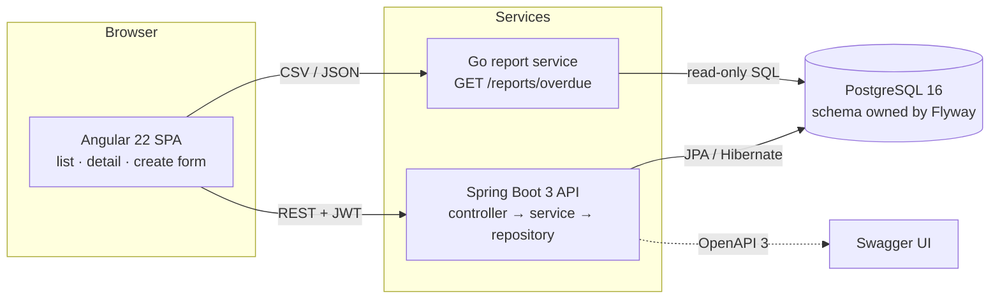

# FieldOps — Work Order & Inventory Management

Full stack work order and inventory management for field maintenance teams.
Supervisors raise work orders against equipment, assign technicians, and record
the spare parts each repair consumes — with the store room count kept correct in
the same transaction.

Built as a portfolio project to exercise the stack in the SLB full stack
engineer role: **Java 21 / Spring Boot 3, JPA & Hibernate, PostgreSQL, Angular,
Go**, with test-driven development throughout.

---

## Tech stack

| Layer | Technology |
|---|---|
| Backend | Java 21, Spring Boot 3.5, Spring Data JPA / Hibernate, Spring Security, Bean Validation |
| Database | PostgreSQL 16, schema owned by Flyway migrations |
| API docs | springdoc-openapi 2 (OpenAPI 3 + Swagger UI) |
| Auth | Stateless JWT (JJWT), roles ADMIN / SUPERVISOR / TECHNICIAN, BCrypt hashes |
| Frontend | Angular 22, standalone components, signals, reactive forms, lazy routes |
| Report service | Go 1.25, standard library net/http, lib/pq |
| Testing | JUnit 5, Mockito, AssertJ, MockMvc, Testcontainers; Vitest + jsdom; Go testing |
| Build & CI | Maven wrapper, npm, Go modules, Docker Compose, GitHub Actions |

---

## Architecture



The Go service reads the same database directly rather than calling the Java
API. That is a deliberate choice for a reporting workload: the report is a
read-only aggregate over a table the backend owns, and going through the API
would add a hop without adding a guarantee.

### Backend layering

```
controller  ── HTTP, validation, status codes. Never touches an entity.
   ↓
service     ── transactions and business rules. Returns DTOs.
   ↓
repository  ── Spring Data JPA.
   ↓
domain      ── entities. The lifecycle rules live on WorkOrder itself.
```

Entities are never serialised to the client; every endpoint speaks in DTOs.

---

## Features

### Implemented

**Work orders**
- Raise a work order against an asset, with priority and optional technician
- Unique generated references (WO-000001) drawn from a database sequence
- Assign and reassign technicians
- Move along the lifecycle OPEN → ASSIGNED → IN_PROGRESS → CLOSED, with
  unassign (ASSIGNED → OPEN) and send-back (IN_PROGRESS → ASSIGNED)
- Consume parts, decrementing store room stock in the same transaction
- List with status filter, pagination and default sort by opened date
- Optimistic locking on work orders and parts

**Business rules** (each unit tested before it was implemented)
- A work order only moves along the transitions the lifecycle permits
- A work order cannot be closed without an assigned technician — enforced in the
  domain model *and* by a check constraint on the table
- Consuming a part fails if the store room holds fewer units than requested, and
  leaves both the part line and the stock level untouched when it does
- Consuming the same part twice merges into one line rather than duplicating it

**Reference data**
- Full CRUD for sites, assets, technicians and parts, with uniqueness on the
  natural keys (site code, asset tag, employee number, SKU)

**Security**
- JWT bearer authentication with ADMIN, SUPERVISOR and TECHNICIAN roles
- Reference-data writes and technician assignment restricted to supervisors and
  admins; deletes restricted to admins
- Login failures return one message regardless of cause, so the endpoint does
  not confirm which usernames exist

**API surface**
- Consistent JSON error shape for every failure, with per-field validation
  violations
- OpenAPI 3 document and Swagger UI

**Frontend**
- Work order list with status filter and loading / empty / error states
- Work order detail: assign a technician, consume a part, and only the status
  buttons the backend says are legal right now
- Create form using reactive forms with validation messages
- JWT interceptor and a sign-in screen

**Report service (Go)**
- GET /reports/overdue?days=N&format=json|csv
- Dependency-light, graceful shutdown on SIGINT / SIGTERM
- Report logic behind a Store interface so it is tested without a database

**Infrastructure**
- `docker compose up` runs PostgreSQL, backend, frontend and report service
- GitHub Actions runs the Java, Go and Angular suites plus a Docker build on
  every push

### Roadmap — not implemented

These are genuinely not built. They are listed because they are the honest next
steps, not because anything above is half-finished.

- **Refresh tokens and token revocation.** Access tokens are issued with a fixed
  expiry and cannot be revoked before it.
- **User management endpoints.** Users exist as seeded rows; there is no UI or
  API to create or disable them.
- **Preventive maintenance scheduling** — recurring work orders generated on a
  calendar or runtime-hours trigger.
- **Attachments** — photos and documents against a work order.
- **Purchase orders and reordering** — a low-stock threshold that raises a
  purchase request.
- **Email / push notification** on assignment and on breach of an SLA.
- **Audit history** — who changed what and when, beyond the current status.
- **Frontend pagination controls.** The API is paginated; the list screen
  currently shows the first page only.
- **Offline-capable mobile view** for technicians working without signal.
- **Role-aware UI.** The backend enforces roles; the frontend does not yet hide
  the controls a technician is not permitted to use.

---

## Running it locally

### With Docker (everything, one command)

```bash
docker compose up --build
```

| Service | URL |
|---|---|
| Frontend | http://localhost:4200 |
| Backend API | http://localhost:8080/api |
| Swagger UI | http://localhost:8080/swagger-ui.html |
| Report service | http://localhost:8081/reports/overdue |
| PostgreSQL | localhost:5432, database `fieldops`, user `fieldops`, password `fieldops` |

Flyway creates the schema and loads demo data on first start.

**Demo logins** (seeded, development only):

| Username | Password | Role |
|---|---|---|
| `admin` | `admin123` | ADMIN |
| `supervisor` | `super123` | SUPERVISOR |
| `tech` | `tech123` | TECHNICIAN |

### Without Docker

You need JDK 21, Node 20+, Go 1.22+ and a PostgreSQL 16 on localhost:5432 with
database `fieldops` and user/password `fieldops`/`fieldops`.

```bash
# Backend — http://localhost:8080
cd backend && ./mvnw spring-boot:run

# Frontend — http://localhost:4200, proxies /api to the backend
cd frontend && npm install && npm start

# Report service — http://localhost:8081
cd report-service && go run .
```

---

## Running the tests

```bash
# Backend unit tests
cd backend && ./mvnw test

# Backend unit + Testcontainers integration tests (needs a running Docker)
cd backend && ./mvnw verify

# Frontend
cd frontend && npm run test:ci

# Go report service
cd report-service && go test ./...
```

The backend integration tests start a real PostgreSQL 16 container through
Testcontainers, run the actual Flyway migrations against it, and assert on the
behaviour that only shows up against a real database — the entity graphs, the
check constraints, and the transactional rollback of a stock shortfall.

---

## API overview

Full interactive documentation: **http://localhost:8080/swagger-ui.html**

Every endpoint except `/api/auth/login` requires `Authorization: Bearer <token>`.

### Authentication

| Method | Path | Description |
|---|---|---|
| POST | `/api/auth/login` | Exchange username and password for a token |

### Work orders

| Method | Path | Description | Role |
|---|---|---|---|
| GET | `/api/work-orders?status=&page=&size=` | List, filterable by status | any |
| GET | `/api/work-orders/overdue?days=7` | Still open after N days | any |
| GET | `/api/work-orders/{id}` | Detail with parts and legal next statuses | any |
| POST | `/api/work-orders` | Raise a work order | any |
| POST | `/api/work-orders/{id}/technician` | Assign a technician | ADMIN, SUPERVISOR |
| POST | `/api/work-orders/{id}/status` | Move to another status | any |
| POST | `/api/work-orders/{id}/parts` | Consume a part | any |
| DELETE | `/api/work-orders/{id}` | Delete | ADMIN |

### Reference data

GET, POST, PUT and DELETE on `/api/sites`, `/api/assets`, `/api/technicians`
and `/api/parts`. Writes require ADMIN or SUPERVISOR; deletes require ADMIN.
`/api/assets` accepts an optional `?siteId=` filter.

### Report service

| Method | Path | Description |
|---|---|---|
| GET | `/reports/overdue?days=7&format=json` | Overdue work orders as JSON |
| GET | `/reports/overdue?days=7&format=csv` | The same report as a CSV download |
| GET | `/health` | Liveness probe |

### Error shape

Every failure returns the same body:

```json
{
  "timestamp": "2026-03-20T09:15:22.114Z",
  "status": 409,
  "error": "Conflict",
  "message": "Insufficient stock for part SEAL-101: requested 5, available 2",
  "path": "/api/work-orders/12/parts",
  "violations": []
}
```

| Status | When |
|---|---|
| 400 | Validation failure; `violations` lists the offending fields |
| 401 | Missing, expired or invalid token |
| 403 | Authenticated but not permitted |
| 404 | No such record |
| 409 | Business rule violation, or an optimistic lock clash |

---

## Repository layout

```
backend/         Spring Boot 3 API (Java 21, Maven wrapper)
frontend/        Angular 22 single page application
report-service/  Go overdue-work-order reporting service
docs/            SPECIFICATION.md, ER-DIAGRAM.md
docker-compose.yml
.github/workflows/ci.yml
```

## Documentation

- [Specification](docs/SPECIFICATION.md) — problem statement, roles, functional
  and non-functional requirements, the work order lifecycle
- [ER diagram](docs/ER-DIAGRAM.md) — the schema as a Mermaid diagram, with the
  constraints and indexes explained

## Licence

MIT
