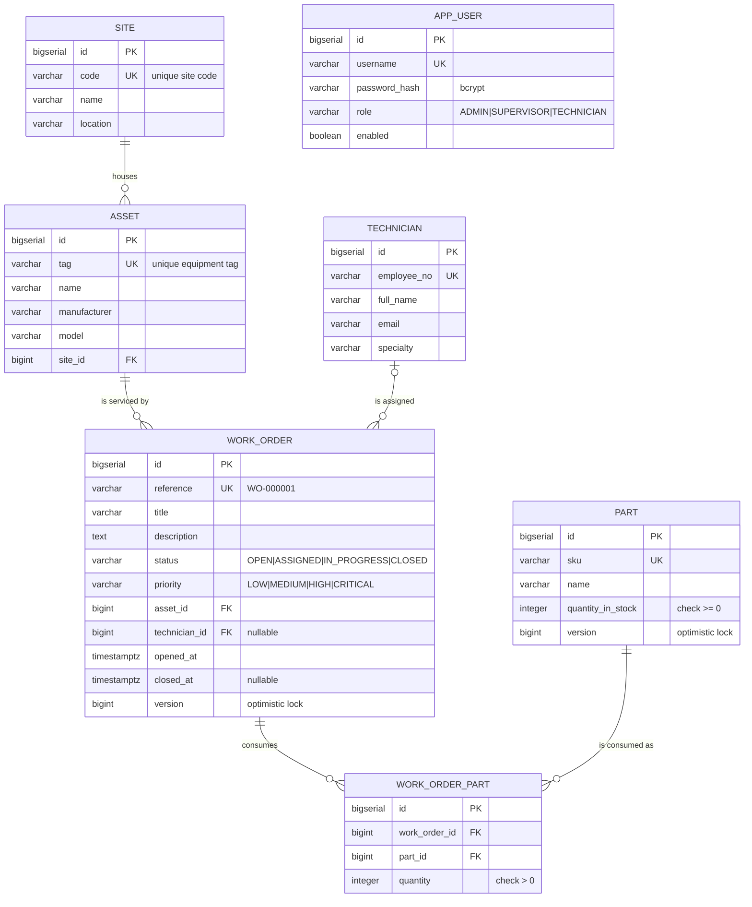

# FieldOps — Entity relationship diagram

The schema is created by `backend/src/main/resources/db/migration/V1__init_schema.sql`.

## Relationship notes

| Relationship | Cardinality | Why |
|---|---|---|
| Site → Asset | one-to-many, mandatory | Every asset stands somewhere; an asset cannot exist without a site. |
| Asset → WorkOrder | one-to-many, mandatory | A work order is always raised against a specific piece of equipment. |
| Technician → WorkOrder | zero-or-one to many | A work order starts life unassigned, so `technician_id` is nullable. |
| WorkOrder ↔ Part | many-to-many via `WORK_ORDER_PART` | The join carries a quantity, so it is modelled as its own entity rather than a plain join table. |

## Constraints worth calling out

- `uq_work_order_part (work_order_id, part_id)` — a work order holds at most one
  line per part; consuming the same part twice merges into that line.
- `chk_part_stock_not_negative` — the store room quantity can never go below
  zero, independently of the service-layer check.
- `chk_closed_requires_technician` — `status <> 'CLOSED' OR technician_id IS NOT
  NULL`. The business rule restated where the data lives.
- `chk_work_order_part_quantity` — a consumed quantity is always positive.

## Indexes

| Index | Column(s) | Serves |
|---|---|---|
| `idx_work_order_status` | `status` | the list screen's status filter |
| `idx_work_order_opened_at` | `opened_at` | default sort and the overdue report |
| `idx_work_order_asset` | `asset_id` | asset history |
| `idx_work_order_technician` | `technician_id` | a technician's queue |
| `idx_asset_site` | `site_id` | assets by site |
| `idx_work_order_part_part` | `part_id` | where a given part was consumed |
